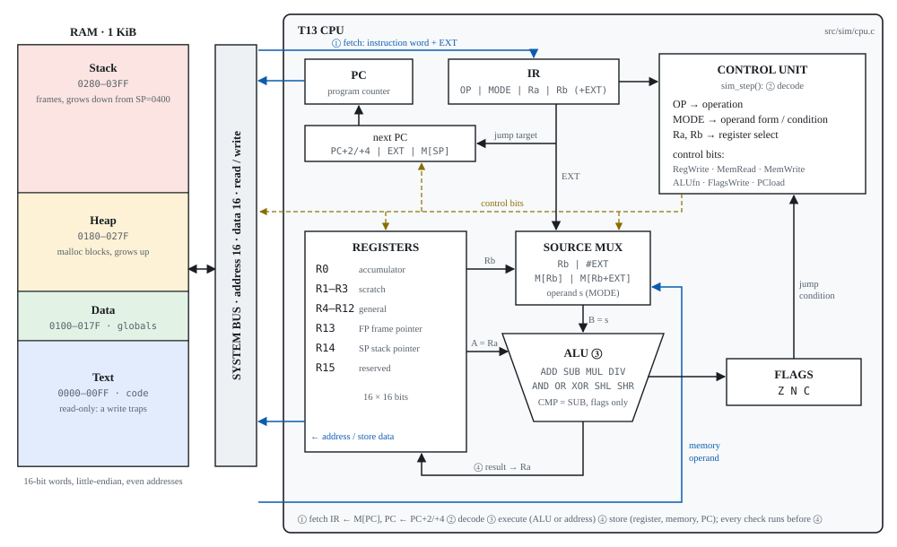
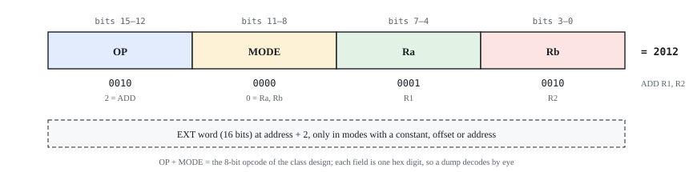
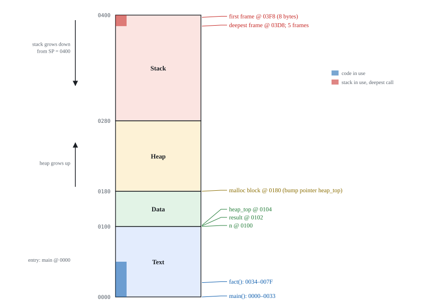
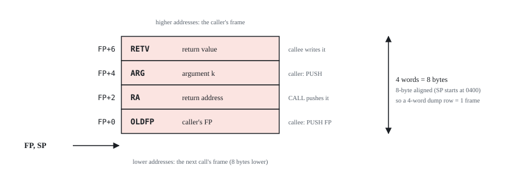

# CMPE 220 Team 13: T13 CPU toolchain

A small 16-bit CPU of our own design, with the C tools to assemble, run and print programs for it.

Course project of Team 13 (Yashashav Devalapalli Kamalraj, Sai Karan Akula, Manoj Konda) for CMPE 220 System Software, San Jose State University, Fall 2026. It is open source (MIT, see [`LICENSE`](LICENSE)) as a learning resource. If you are taking this course, follow your instructor's academic integrity rules and do not submit this work as your own.

| Tool | Does | Charter owner | Status |
|---|---|---|---|
| `isa.c` (shared) | encode / decode / disassemble one instruction | Yashashav | done, tested |
| `t13as` | assembly to memory image + listing | Yashashav | done, tested |
| `t13sim` | load image, run, produce execution trace | Sai Karan | done, tested |
| `t13view` | trace to memory tables for the report | Manoj | done, tested |

## CPU Architecture

The T13 is a 16-bit CPU with 16 registers, a three-flag ALU, and a four-stage instruction cycle (fetch, decode, execute, store). The datapath connects RAM through a system bus to the register file, source mux, ALU, and control unit:

<p align="center">
  
</p>

### Instruction Format

Every instruction is a 16-bit word split into four 4-bit fields (OP, MODE, Ra, Rb). Some modes add a second 16-bit EXT word for constants, offsets, or addresses:

<p align="center">
  
</p>

## Memory Layout

Programs run in a 1 KiB address space divided into four segments: Text (code), Data (globals), Heap (grows up), and Stack (grows down). Here is the layout for the recursive factorial program:

<p align="center">
  
</p>

### Stack Frame Structure

Each function call creates an 8-byte (4-word) stack frame. The frame holds the return value slot, the argument, the return address pushed by `CALL`, and the saved frame pointer:

<p align="center">
  
</p>

## Project Reports

The project report PDFs are saved in [`report/`](report/):

- **Part 1: CPU Design and Programs**: [`report/Team13_Part1_CPU_Design.pdf`](report/Team13_Part1_CPU_Design.pdf)
  - 16-bit T13 ISA specification, encoding tables, CPU architecture, and datapath diagram
  - Assembler design (`t13as`), simulator engine (`t13sim`), and execution traces
  - Program A (8^2 by repeated multiplication) and Program B (8! iterative factorial) with full memory waterfalls and grids
- **Part 2: Program Layout, ABI and Recursion**: [`report/Team13_Part2_Program_Layout.pdf`](report/Team13_Part2_Program_Layout.pdf)
  - 1 KiB memory segmentation layout (Text, Data, Heap, Stack) and 4-word frame structure (`docs/abi.md`)
  - Subroutine calling sequence (`CALL` / `RET`) and frame pointer management
  - Recursive factorial program (`recfact.s`, fact(5) = 120) with step-by-step stack frame dumps and memory segment snapshots

To build the report PDFs from source:
```sh
make report
```

## Quick start

Needs a C99 compiler and `make` (macOS clang or Linux gcc). From the repository root:

```sh
make check
```

That builds the three tools, runs every test, then assembles, simulates and prints every program. Expected: each test suite ends in `0 failed`, then `golden: all passed`, `programs: all passed`, and the views land in `build/views/<program>.<view>.txt`.

| Command | Does |
|---|---|
| `make` | build `build/t13as`, `build/t13sim`, `build/t13view` and the unit-test binaries |
| `make test` | unit tests, golden-file tests (`tests/golden.sh`), every program end to end (`tests/programs.sh`) |
| `make run` | assemble + simulate every `programs/*.s`; images, listings and traces in `build/programs/`, views in `build/views/` |
| `make report` | the two report PDFs in `build/report/` (needs Python 3 and Chrome/Chromium, or WeasyPrint) |
| `make clean` | remove `build/` |

## One program by hand

```sh
build/t13as programs/power.s -o power.img -l power.lst   # assemble: image + listing
build/t13sim power.img -o power.trc                       # run: "power.img: HALT after 17 steps, PC=0024"
build/t13view power.trc --waterfall                       # memory after every instruction
build/t13view power.trc --peek result                     # result=64
```

| `t13view` view | Shows |
|---|---|
| `--summary` (default) | END line, final registers and flags, memory words that changed |
| `--waterfall` | one row per executed instruction: changing registers, flags and memory words; `*` = changed |
| `--grid` | the program's memory block after loading and at the end |
| `--blocks` | the memory block again after every instruction |
| `--loaded` | the executable as loaded into memory: Text decoded, Data with labels |
| `--segments` | Text / Data / Heap / Stack at load, at each `CALL` and `RET`, and at `HALT`; the stack one frame per row |
| `--peek NAME` / `--peek '*NAME'` | the final value of `M[NAME]` / `M[M[NAME]]` |

Add `--html` for the report's HTML tables. Exit codes for all three tools: 0 success, 1 the program or source is wrong (errors on stderr), 2 usage or unreadable input.

## Programs

| File | Part | What it computes | Expected result |
|---|---|---|---|
| `programs/power.s` | 1, Program A (written in assembly) | 8² = BASE^EXP by repeated multiplication | `M[result] = 0x0040` (64), 17 instructions |
| `programs/fact.c` / `programs/fact.s` | 1, Program B (C translated by hand) | 8! in a loop inside a function called from main | `M[result] = 0x9D80` (40320), 57 instructions |
| `programs/recfact.c` / `programs/recfact.s` | 2 (main + recursive function) | fact(5), answer stored in a heap block | `M[M[result]] = 0x0078` (120), 112 instructions, 5 stack frames |

`tests/programs.sh` compiles each `.c` with the host compiler and checks that it prints exactly what `t13sim` leaves in memory, so the hand translation is checked on every run.

CI ([`.github/workflows/ci.yml`](.github/workflows/ci.yml)) runs `make` and `make test` on every pull request and every push to `main`, on Linux with gcc and clang and on macOS with clang.

## Layout

```
docs/isa.md            ISA specification: encoding tables, execution rules, memory map
docs/asm.md            assembler manual: syntax, directives, listing, errors
docs/image.md          memory image (.img) format: t13as -> t13sim
docs/trace.md          execution trace (.trc) format: t13sim -> t13view
docs/abi.md            calling convention, stack frame, C -> assembly recipe
include/isa_ops.def    opcode table, one line per operation (X-macro)
include/isa.h          codec API shared by all three tools
src/common/isa.c       codec implementation
src/asm/               t13as:   parse.c symtab.c select.c assemble.c image.c listing.c main.c
src/sim/               t13sim:  load.c (loader) cpu.c (fetch/decode/execute/store) trace.c main.c
src/view/              t13view: read.c (trace reader) render.c (views) main.c
programs/              example programs, .s and the .c they were translated from
tests/                 unit tests (test_*.c), golden.sh, programs.sh, golden/ expected outputs
report/                build.py + report.css: the report PDFs, built from tool outputs
.github/workflows/     CI
```

## Using the codec

```c
#include "isa.h"

uint8_t mem[4];
size_t len;
isa_insn in = { OP_MOV, 1, 1, 0, 5, 0 };   /* MOV R1, #5 */
isa_encode(&in, mem, sizeof mem, &len);    /* mem = 10 11 05 00, len = 4 */

isa_insn out;
char text[32];
isa_decode(mem, len, &out, &len);
isa_disasm(&out, text, sizeof text);       /* "MOV R1, #5" */
```

To add or change an instruction, edit its line in `include/isa_ops.def`, the matching rows in `src/asm/select.c`, the execution in `src/sim/cpu.c` and the tables in `docs/isa.md`, then run `make test`.
